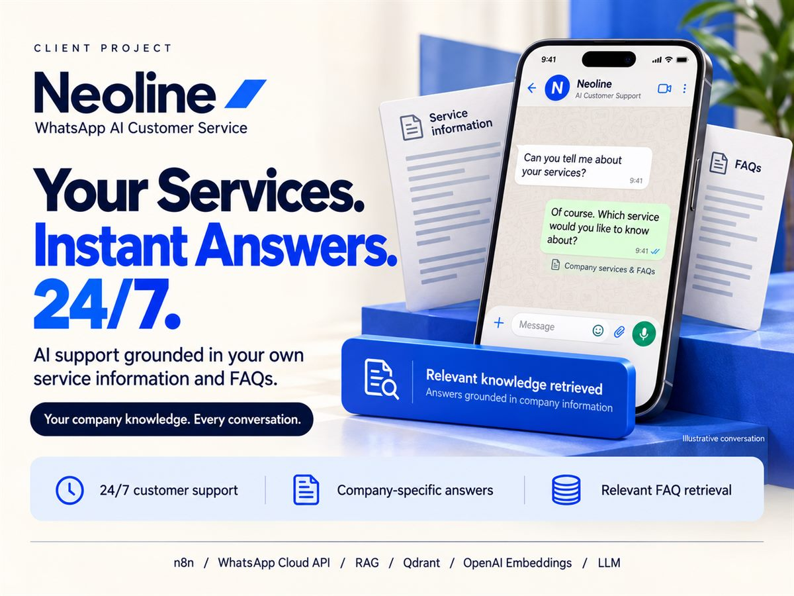
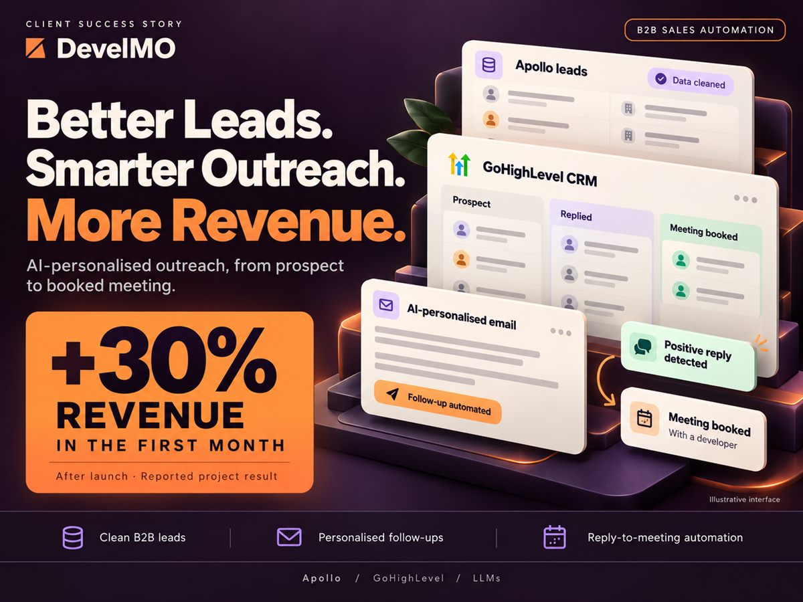

# n8n AI Automations

Production n8n workflows I built for real businesses: a multi-agent WhatsApp sales bot, an SEO blog pipeline, an AI voice agent for outbound sales calls, website support chatbots and a vision-based nutrition API.

Each workflow ran for a real client. Before publishing I removed credentials, API keys, account IDs and customer data, so every file imports into n8n with `YOUR_…` placeholders where your own values go.

| Workflow | What it does | Built with |
| --- | --- | --- |
| [**WhatsApp battery sales bot**](whatsapp-battery-sales-bot) | Two AI agents sell car batteries on WhatsApp for CarBatterySquad in Dubai. One reads the label from a customer's battery photo, the other quotes from live stock and books the order. **97% of 200 test scenarios fully correct, 100% price accuracy.** | Claude Sonnet 4.6, WhatsApp Cloud API, Google Sheets |
| [**SEO blog automation**](seo-blog-automation) | Takes the next topic from a sheet, researches it with live web search, writes an 1,800-word SEO article and publishes it to the CMS, three times a day. | LLM with web search, Google Sheets, REST API |
| [**AI voice agent: outbound calls**](ai-voice-agent-outbound) | Calls each lead with a personalised opening line, then writes the outcome (need, email, meeting date, summary) back to the lead sheet. | ElevenLabs Conversational AI, Twilio, Google Sheets |
| [**VPN support chatbots**](vpn-support-chatbots) | Website support assistants for Sylink and SecureTapVPN that answer only from each company's approved information and hand off to a live agent when needed. **500+ questions a month, 90% resolved without staff.** | DeepSeek, webhooks, chat memory |
| [**FoodMate nutrition API**](foodmate-nutrition-api) | Two endpoints for a nutrition app: estimate calories and macros from a meal photo, and suggest 5 meals that fit a user's goal and allergies. | GPT-5.4 vision, GPT-5.4-mini, webhooks |

## More client projects

Two more automation projects whose workflows aren't published here.

| Neoline: WhatsApp AI customer service | DevelMO: GoHighLevel CRM lead generation |
| --- | --- |
|  |  |
| Answers any question about Neoline's services from its own service information and FAQs, using RAG with Qdrant and OpenAI embeddings. | Pulls B2B leads from Apollo into GoHighLevel, sends AI-personalised emails with automated follow-ups, analyses the sentiment of every reply and books a meeting for each positive one. **+30% revenue in the first month.** |

## Import a workflow

1. In n8n, open **Workflows → Import from File** and choose a `.json` file.
2. Connect the credentials listed in that folder's README.
3. Search the workflow for `YOUR_` and replace each placeholder with your own value.

## About me

I'm Sheraz Ahmad, an AI engineer in Lahore, Pakistan, building AI agents, RAG systems and business automation.
[Portfolio](https://sheraz-portfolio-beige.vercel.app) · [LinkedIn](https://www.linkedin.com/in/sheraz--ahmad) · [GitHub](https://github.com/25sheraz)
