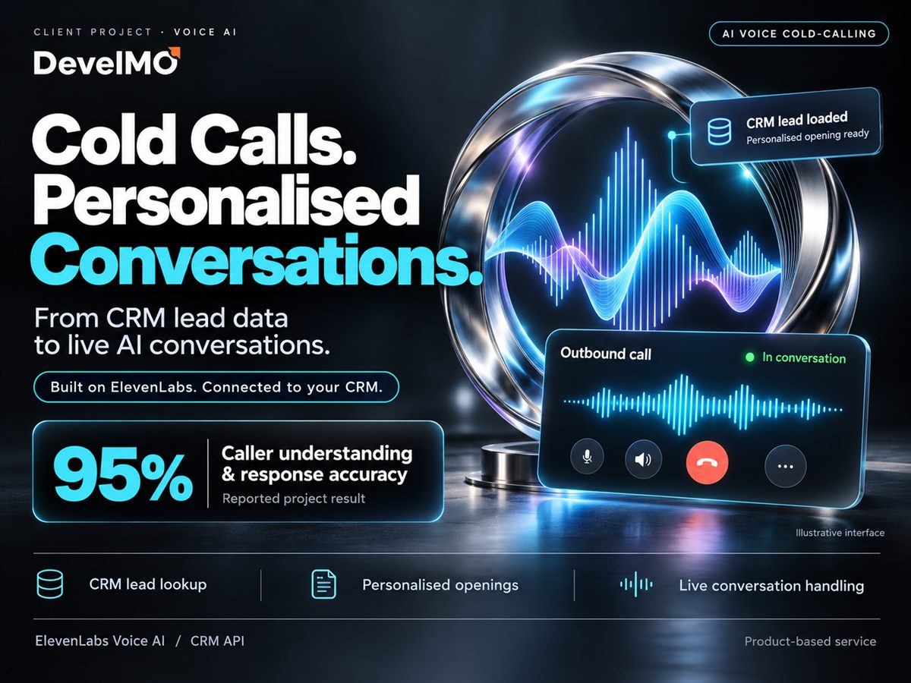
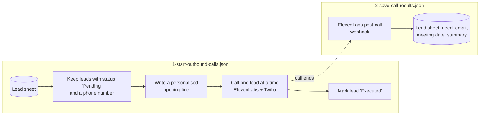

# AI Voice Agent: Outbound Sales Calls

Two workflows that run cold calls with an ElevenLabs voice agent and keep the lead sheet up to date. Built at DevelMO, where the agent is now sold as a product: [DevelMO AI Voice Agent](https://develmo.com/our-products/ai-voice-agent). It understands callers and responds correctly 95% of the time.

## How it works

- **Personalised openings.** The first line changes with what the sheet knows. With a name and company it mentions both, and there are versions for name only, company only or neither. Each case has several variants picked at random, so calls don't all sound the same.
- **Context for the agent.** Each call passes the lead's name, company, interest and lead number to the agent as dynamic variables.
- **Paced calling.** Leads are called one at a time with a short pause between calls, and each row is marked as soon as its call starts.
- **Results written back.** When a call ends, ElevenLabs posts its analysis to a webhook. The workflow saves the prospect's name, company, business need, email, meeting date and a call summary to the lead's row and marks it `Completed`.

## Setup

**Credentials:** ElevenLabs API key (Header Auth, header `xi-api-key`) and Google Sheets (service account). Your ElevenLabs agent needs a Twilio phone number.

**Placeholders to replace:** `YOUR_ELEVENLABS_AGENT_ID`, `YOUR_ELEVENLABS_PHONE_NUMBER_ID`, `YOUR_GOOGLE_SHEET_ID`.

**Lead sheet columns:** Lead-No, Name, Phone Number, Company, Interest, Status, Email, Meeting Date, Summary.

**In ElevenLabs:** point the post-call webhook at `https://<your-n8n>/webhook/elevenlabs-post-call` and add these data collection fields to the agent: `prospect_name`, `company_name`, `business_need`, `prospect_email`, `meeting_date`, `call_summary`.

The opening lines introduce the caller as DevelMO's AI. Edit them in the "Code in JavaScript" node to use your own company name.
