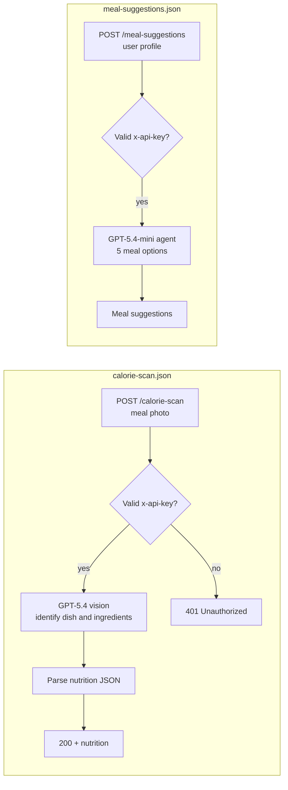

# FoodMate Nutrition API

The AI backend for [FoodMate](https://foodmate.xapcoders.com), a nutrition app. Two n8n webhooks, both protected by an API key, give the app's frontend its AI features.

In testing, meal recognition and nutrient estimates were 90% accurate on clear photos and 79% on blurry ones.

## Endpoints



### `POST /webhook/calorie-scan`

Send a meal photo, with optional ingredient names, weights or notes. The model identifies the dish and every visible ingredient and estimates the nutrition. Names come in English and Roman Urdu (for example Rice → Chawal):

```json
{
  "success": true,
  "dish": { "english_name": "", "roman_name": "", "cuisine": "", "meal_category": "" },
  "ingredients": [
    {
      "english_name": "", "roman_name": "", "confidence": 99,
      "weight_g": 150, "weight_source": "estimated",
      "nutrition": { "calories": 248, "protein": 46.5, "carbohydrates": 0, "fat": 5.4, "fibre": 0 }
    }
  ]
}
```

### `POST /webhook/meal-suggestions`

Send the user's profile. Age, gender, height, weight and goal are required. Allergies, disliked foods, diet, activity level and calorie target are optional; if the calorie target is missing, the agent estimates it. It returns exactly 5 different meals and never suggests a food the user is allergic to.

## Setup

**Credentials:** OpenAI.

**Placeholders to replace:** `YOUR_API_KEY` in the "Check API Token" and "If" nodes. Clients send the same value in an `x-api-key` header.
