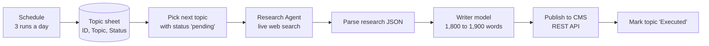

# SEO Blog Automation

Publishes a researched, SEO-optimised blog post from a list of topics, with no manual steps. Built for Tecclub Technology.

## How it works

1. **Topic queue.** A Google Sheet holds the topics. Each run takes the first row whose status is `pending`.
2. **Research first.** The Research Agent must use web search, prefers sources from the last 24 months and official documentation, and must never invent facts. It returns one JSON object: title, meta title and description, slug, category, tags, primary and secondary keywords, search intent, target audience, reading time, an H2/H3 outline and the sources it used.
3. **Writing from the research only.** The writer gets that JSON and produces a complete 1,800–1,900 word article. It follows Google's Helpful Content and E-E-A-T guidelines, uses lists and tables where they help, works the keywords in naturally and adds no claims beyond the research.
4. **Publishing.** The article is posted to the CMS API and the topic row is marked `Executed`, so nothing is published twice.

## Setup

**Credentials:** an OpenAI-compatible API with built-in web search (this workflow used MiMo-V2.5), and Google Sheets (service account).

**Placeholders to replace:** `YOUR_GOOGLE_SHEET_ID`; in the HTTP Request node, the CMS URL (`https://your-cms.example.com/blog/create`) and `YOUR_API_KEY`.
