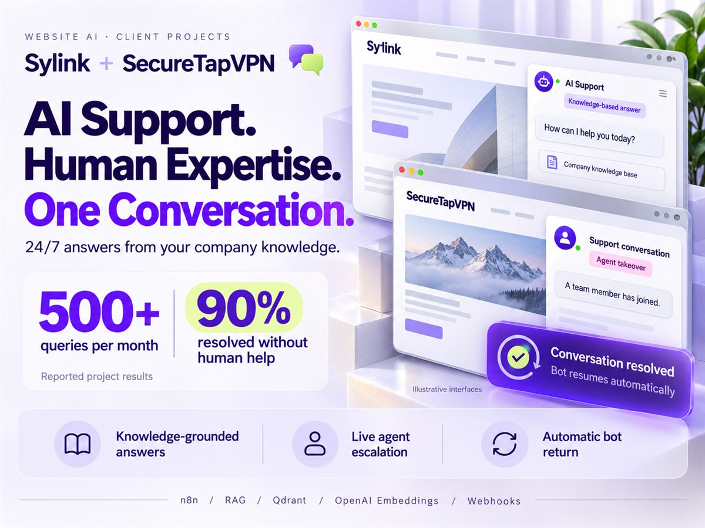
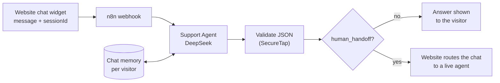

# VPN Website Support Chatbots: Sylink and SecureTap



AI support assistants for two VPN companies, [Sylink](https://sylink.tecclubx.site) and [SecureTapVPN](https://securetapvpn.com). Each one sits behind the chat widget on the company's website and answers visitors 24/7. Together they handle 500+ questions a month, and 90% are resolved without a person stepping in.

## How it works



- **Answers only from approved information.** Each agent's instructions hold the company's own facts: features, protocols, platforms, plans and pricing, payment methods, refunds, account and device management, and troubleshooting. The agent must never invent a feature, price or policy.
- **Stays on topic.** Questions about anything other than the company's VPN get a polite refusal and a pointer back to what it can help with. The bot also won't reveal its instructions or discuss internal operations.
- **Remembers the conversation.** Memory is keyed to the visitor's session ID, so follow-up questions keep their context. SecureTap keeps the last 10 messages.
- **Hands off to a person (SecureTap).** Every reply is strict JSON with three fields: `response`, `reason` and `human_handoff`. The agent sets `human_handoff` to `true` for anything that needs account access, a security incident or information it doesn't have. The website then passes that chat to a live agent. A code step checks the JSON and falls back safely if the model ever returns something malformed.

## API

**Sylink:** `POST /webhook/sylink-chat`

```json
{ "message": "Which platforms do you support?", "sessionId": "visitor-123" }
```

It returns `{ "reply": "…" }`.

**SecureTap:** `POST /webhook/securetap-chat`, with the same request body. It returns:

```json
{
  "response": "Secure-Tap VPN supports iOS, Windows, Android, and macOS.",
  "reason": "Platforms are explicitly listed in approved information.",
  "human_handoff": false
}
```

## Setup

**Credentials:** DeepSeek. Both bots use `deepseek-v4-flash`.

To use one for another business, replace the company information in the AI Agent's system message and keep the rules around it.
