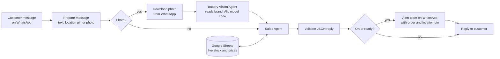

# WhatsApp Battery Sales Bot (multi-agent)

A WhatsApp sales assistant for **CarBatterySquad**, a car battery and jump-start service in Dubai. Customers message it at any hour. It finds the right battery for their car, quotes from live stock, takes the order and alerts the team.

## Test results

Tested on a copy of the live bot with 200 scenarios across 17 areas on 17 October 2026, with WhatsApp sending switched off.

| Measure | Result |
| --- | --- |
| Scenarios fully correct | **97.0%** (194 of 200) |
| Customer's main need met | 98.5% (197 of 200) |
| Action precision | **100%**: no wrong alerts, bookings or quotes |
| Action recall | 99.1% (344 of 347 expected actions) |
| Price accuracy | **100%**: all 128 quoted prices matched the stock sheet |
| Median reply time | 7.2 s (90% of replies within 12.3 s) |
| Languages passed | English, Arabic, Urdu, Roman Urdu, Hindi, mixed Urdu/English |

The tested bot is a few days newer than the workflow in this folder. It also handles a service menu, jump-start bookings and garage photos.

## How it works

- **Two agents with separate jobs.** The Battery Vision Agent only reads the label in a customer's photo and returns JSON: brand, model code, Ah, technology (AGM, EFB, flooded), terminal layout and a confidence level. The Sales Agent works from that JSON and never guesses from the image.
- **Stock matching with rules.** It looks for an exact match on brand, Ah and technology first. Otherwise it offers up to three alternatives (Budget, Mid-Range, Premium) within ±5 Ah, with safe swaps only: AGM is replaced only by AGM, and EFB by EFB or AGM. Items with no stock or no valid price are never quoted.
- **Strict output.** A structured output parser and a validation step check every reply. If the model returns something malformed, the customer gets a short holding message instead of an error.
- **Order hand-off.** Once the battery, price, car, name and contact number are known, the team gets a WhatsApp alert with the order and the customer's location pin.
- **Memory per customer.** Each chat is keyed to the customer's WhatsApp number, and the bot never asks again for car details it already has.
- **Cost control.** The stock sheet is read at most once per quote.

## Setup

**Credentials:** Anthropic, WhatsApp Business Cloud API (trigger and send), Google Sheets (service account).

**Placeholders to replace:** `YOUR_WHATSAPP_PHONE_NUMBER_ID`, `YOUR_TEAM_WHATSAPP_NUMBER`, `YOUR_GOOGLE_SHEET_ID`.

**Stock sheet columns:** Company / Brand, Model / SKU, Capacity / Type, Total Stock, RETAIL incl. VAT, Warranty.

Both agents run on Claude Sonnet 4.6. The full sales rules are in the Sales Agent's system message.
